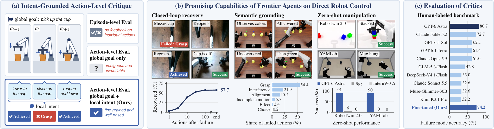

# AgentRoboCritic

AgentRoboCritic evaluates an executed robot action against the actor’s stated local intent. This repository contains the critic evaluation on the human-annotated benchmark and the EFE tools for collecting new intent-grounded actions.

[Paper](https://arxiv.org/abs/2611.26613) · [Project page](https://adu2021.github.io/blog/AgentRoboCritic/) · [Human-annotated benchmark](https://huggingface.co/datasets/cx-cmu/AgentRoboCritic-Bench) · [Fine-tuned critic](https://huggingface.co/cx-cmu/AgentRoboCritic-Muse-Glimmer-30B) · [Training data](https://huggingface.co/datasets/cx-cmu/AgentRoboCritic-Dataset)



**Overview of AgentRoboCritic.** (a) Local intent makes action-level critique fine-grained and well-posed. (b) Capabilities of frontier agents on direct robot control. (c) Evaluation of action-level critics on the human-labeled benchmark.

## Evaluate a critic

Use Python 3.10 or later on Linux or macOS. From a clone of this repository, install the harness in its own environment.

```bash
python -m venv .venv
source .venv/bin/activate
python -m pip install -e .
```

The default input is the pinned `test` split of AgentRoboCritic-Bench. To check the data and request construction before inference, run the following command. It downloads the four public shards on first use. Verification runs locally and makes zero model calls.

```bash
arc verify
```

### Commercial API

From the repository root, create your local key file once:

```bash
cp -n .env.example .env
```

Open `.env` and paste the key for the provider you want to use. For example, fill in `QWEN_API_KEY` for Qwen. The harness reads the nearest `.env` in the current directory or its parents. An existing shell key takes precedence.

```bash
arc evaluate --profile qwen --limit 1 --out runs/qwen
arc evaluate --profile qwen --out runs/qwen
arc score --predictions runs/qwen/predictions.jsonl --out runs/qwen/metrics.json
```

The second command resumes from the first action. Each completed response, including an invalid model answer, is checkpointed. An HTTP error stops the run. Reissue the same command to resume. Use `--workers N` for concurrent requests within your provider’s quota. Each run directory records the requested model and settings, returned model identifiers, token usage when provided, predictions and parsing errors.

These profiles use the benchmark’s binary system prompt, the ordered user text and images, and the provider’s native request format with high reasoning effort. Use `--model` for another compatible snapshot or deployment. The generic `chat` profile accepts an OpenAI-compatible vision endpoint through `--model` and `--base-url`. For a different authenticated endpoint, specify its key variable with `--key-env`. Use `--max-tokens` to change the output token budget. Provider aliases can change over time.

### Fine-tuned critic on GPUs

On a GPU node, use a vLLM environment with Muse-Glimmer multimodal support and the `muse_glimmer` reasoning parser. We tested the server with vLLM 0.31.0. Run the following server on the allocated node, then run the harness in a second shell on the same node. The launcher pins the public merged checkpoint and defaults to two GPUs, bfloat16, and a 131,072-token context.

```bash
bash scripts/serve_muse.sh
```

```bash
arc evaluate --profile muse --out runs/muse
arc score --predictions runs/muse/predictions.jsonl --out runs/muse/metrics.json
```

The `muse` profile uses the fine-tuning system prompt, the benchmark user turn and original PNG bytes, temperature 0, seed 42, and a 1,024-token response budget. Our reported results use a Fireworks deployment of the same checkpoint. To evaluate your own deployment with these settings, fill in `FIREWORKS_API_KEY` in `.env` and use `--profile fireworks --model YOUR_DEPLOYMENT_ID`. To evaluate the base model without fine-tuning, serve `meta-models/Muse-Glimmer-30B` and use `--profile muse-base`. Serving engines and provider model revisions can affect generated outputs.

### Data and scoring

Each Parquet row has four columns. `id` identifies one executed action chunk. `messages` contains a system turn and a user turn with ordered text and image placeholders. `images` contains one embedded PNG per placeholder in the same order. `human_label` contains `intent_success`, `failure_mechanism`, and `m1_subcategory`. Inference reads only the first three columns. To use a local file or directory of `test-*.parquet` shards, pass the same `--data PATH` to evaluation and scoring.

The critic returns a JSON object with those three judgment fields and `failure_reason`. Scoring joins on action ID and checks that the predictions cover the selected cohort. Outcome accuracy uses all 400 actions. Failure-mode accuracy uses the 264 human-labeled failures. Overall accuracy requires both outcome and failure mode to agree with the reference, with a null mode on successes. The grasp sub-category and the explanation are not scored. Invalid outputs count as incorrect. The report also includes Cohen’s κ for outcome and failure mode.

| Critic | Outcome (400) | Failure mode (264) | Overall (400) |
|---|---:|---:|---:|
| AgentRoboCritic-Muse-Glimmer-30B | 305 (76.25%) | 196 (74.24%) | 271 (67.75%) |

`arc verify` checks that the requests built for all 400 actions and 6,936 images match those of our evaluation of the fine-tuned critic.

## Collect intent-grounded EFE data

Prepare an EFE Standard task, run the actor with Harbor, and convert the collected trial into a benchmark-format Parquet shard. The actor supplies one prospective note per submitted action chunk. The converter binds that note, the submitted command, execution metadata and camera evidence using EFE’s native call ID. See the [collection and conversion instructions](efe/README.md).

## Run the tests

```bash
python -m pip install -e '.[dev]'
pytest -q
```

## Citation

```bibtex
@misc{du2026agentrobocritic,
  title         = {AgentRoboCritic: Understanding the Capability of Frontier Agents on Direct Robot Control},
  author        = {Yiyang Du and Yuxuan Kuang and Qitao Zhao and Yixuan Wang and Zhanqiu Guo and Yi Xu and Xin Li and Wenbin He and Liu Ren and Chenyan Xiong},
  year          = {2026},
  eprint        = {2611.26613},
  archivePrefix = {arXiv},
  primaryClass  = {cs.RO},
  url           = {https://arxiv.org/abs/2611.26613}
}
```

## License

The code in this repository is released under the [MIT License](LICENSE). The model, datasets, and upstream EFE simulators and assets carry their respective licenses.
